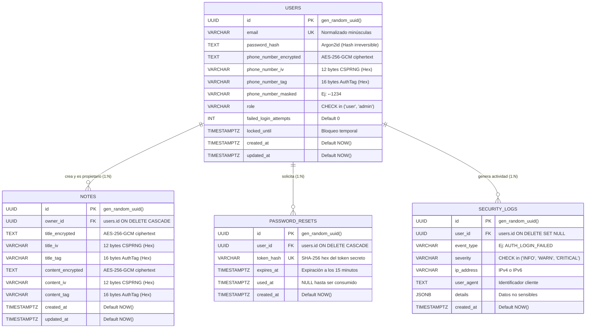
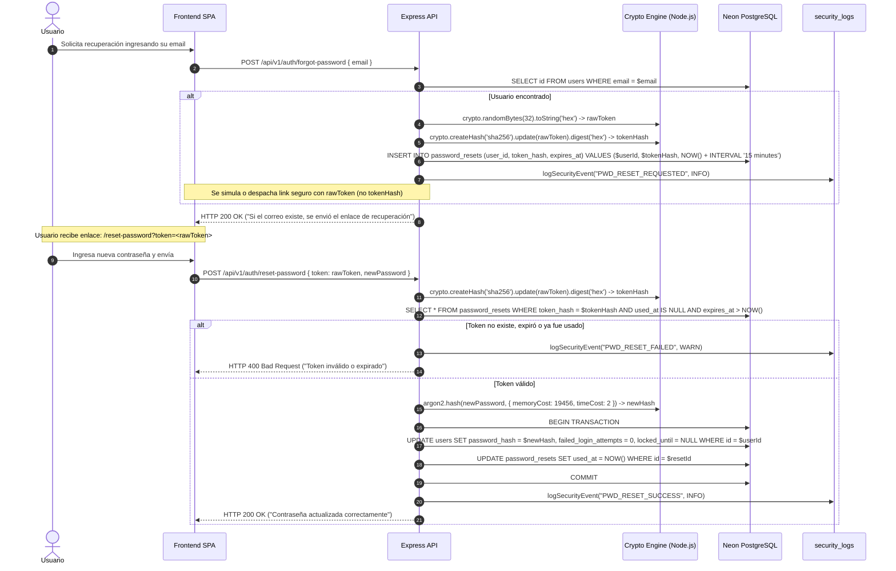
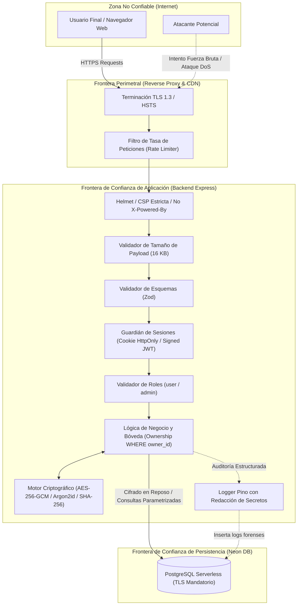

# SecureVault — Documento de Diseño y Modelado de Amenazas (Fase 1)
**Proyecto:** SecureVault — Bóveda Web Segura para Notas Privadas y Datos Sensibles  
**Versión:** 1.0.0  
**Estándar:** OWASP Top 10:2025 / NIST SP 800-63B / NIST SP 800-38D  
**Stack Tecnológico:** Node.js (ESM), Express, PostgreSQL (Neon Serverless), React + Vite  

---

## 1. Arquitectura General del Sistema

SecureVault implementa el principio de **Defensa en Profundidad (Defense in Depth)** y **Privilegio Mínimo (Least Privilege)** para mitigar vectores de ataque web modernos. El sistema desacopla el cliente web (React SPA) de la API REST mediante un canal seguro cifrado por TLS 1.3, autenticación basada en cookies con flags de máxima protección (`HttpOnly`, `Secure`, `SameSite=Strict`) y cifrado a nivel de aplicación (Envelope/Field-level Encryption) antes de persistir datos sensibles en la base de datos PostgreSQL.

---

## 2. Modelo de Datos Relacional

### 2.1 Especificación Criptográfica de Columnas

| Tabla | Columna | Tipo SQL | Clasificación de Seguridad | Mecanismo Criptográfico / Mitigación |
| :--- | :--- | :--- | :--- | :--- |
| `users` | `id` | `UUID` | Identificador único | Generado con `gen_random_uuid()` (CSPRNG). |
| `users` | `email` | `VARCHAR(255)` | PII / Identidad | Normalizado a minúsculas, índice único. |
| `users` | `password_hash` | `TEXT` | Credencial de Autenticación | **Hash Irreversible Lento:** `Argon2id` (memoryCost: 19456 KiB, timeCost: 2, parallelism: 1). Resistente a GPU/ASIC. |
| `users` | `phone_number_encrypted` | `TEXT` | PII Sensible | **Texto Cifrado:** `AES-256-GCM`. Cifrado simétrico autenticado. |
| `users` | `phone_number_iv` | `VARCHAR(32)` | Vector de Inicialización | 12 bytes aleatorios (hex/base64), único por operación (CSPRNG). |
| `users` | `phone_number_tag` | `VARCHAR(32)` | Etiqueta de Autenticación | 16 bytes (authTag) de `AES-256-GCM` para integridad y autenticidad. |
| `users` | `phone_number_masked` | `VARCHAR(20)` | PII Enmascarada | Formato ofuscado (`***-***-1234`) para visualización segura sin descifrar. |
| `users` | `role` | `VARCHAR(20)` | Control de Acceso | Restricción `CHECK (role IN ('user', 'admin'))`. Validado en servidor (RBAC). |
| `users` | `failed_login_attempts` | `INT` | Resiliencia contra Fuerza Bruta | Contador incremental para bloqueo de cuenta tras 5 intentos fallidos. |
| `users` | `locked_until` | `TIMESTAMPTZ` | Control de Bloqueo | Marca de tiempo temporal (15 min) para reactivación automática. |
| `notes` | `id` | `UUID` | Identificador único | Generado con `gen_random_uuid()`. |
| `notes` | `owner_id` | `UUID` | Aislamiento Multi-inquilino | FK `users(id) ON DELETE CASCADE`. Mitigación de IDOR (A01). |
| `notes` | `title_encrypted` | `TEXT` | Confidencialidad de Nota | **Texto Cifrado:** `AES-256-GCM`. |
| `notes` | `title_iv` | `VARCHAR(32)` | Vector de Inicialización | 12 bytes CSPRNG exclusivos para el título. |
| `notes` | `title_tag` | `VARCHAR(32)` | Autenticidad de Título | 16 bytes (authTag) de verificación de integridad. |
| `notes` | `content_encrypted` | `TEXT` | Confidencialidad de Contenido | **Texto Cifrado:** `AES-256-GCM`. Datos en reposo siempre cifrados. |
| `notes` | `content_iv` | `VARCHAR(32)` | Vector de Inicialización | 12 bytes CSPRNG exclusivos para el contenido. |
| `notes` | `content_tag` | `VARCHAR(32)` | Autenticidad de Contenido | 16 bytes (authTag). Si se altera 1 bit en DB, el descifrado falla. |
| `password_resets` | `id` | `UUID` | Identificador único | `gen_random_uuid()`. |
| `password_resets` | `user_id` | `UUID` | Relación de Usuario | FK `users(id) ON DELETE CASCADE`. |
| `password_resets` | `token_hash` | `VARCHAR(64)` | Secreto Temporal | **Hash Irreversible Rápido:** `SHA-256` del token unívoco enviado por correo. El token en texto plano nunca toca la base de datos. |
| `password_resets` | `expires_at` | `TIMESTAMPTZ` | Control de Validez | Expiración estricta de 15 minutos desde la emisión. |
| `password_resets` | `used_at` | `TIMESTAMPTZ` | Uso Único | Control contra ataques de repetición (Replay Attacks). |
| `security_logs` | `id` | `UUID` | Identificador de Auditoría | `gen_random_uuid()`. |
| `security_logs` | `user_id` | `UUID` | Trazabilidad | FK `users(id) ON DELETE SET NULL` (preserva registro forense si el usuario es eliminado). |
| `security_logs` | `event_type` | `VARCHAR(50)` | Categoría Forense | Ej. `AUTH_LOGIN_SUCCESS`, `AUTH_LOGIN_LOCKED`, `NOTE_TAMPERED`. |
| `security_logs` | `severity` | `VARCHAR(20)` | Nivel de Riesgo | Restricción `CHECK (severity IN ('INFO', 'WARN', 'CRITICAL'))`. |
| `security_logs` | `ip_address` | `VARCHAR(45)` | Metadato Forense | Soporte IPv4 e IPv6. Sanitizado. |
| `security_logs` | `user_agent` | `TEXT` | Huella de Cliente | Truncado y sanitizado. |
| `security_logs` | `details` | `JSONB` | Contexto de Evento | Metadatos contextuales redactados sin credenciales ni secretos. |

---

### 2.2 Diagrama Entidad-Relación (Mermaid)



---

## 3. Flujo de Autenticación, Sesiones y Recuperación

### 3.1 Diagrama de Secuencia: Inicio de Sesión y Verificación de Rol (RBAC)

```mermaid
sequenceDiagram
    autonumber
    actor Usuario
    participant Frontend as Frontend SPA (React + Vite)
    participant RateLimiter as Rate Limiter (A07)
    participant Backend as Backend API (Express)
    participant DB as Neon PostgreSQL (TLS)
    participant Logger as Pino Logger / Auditoría

    Usuario->>Frontend: Ingresa correo y contraseña
    Frontend->>RateLimiter: POST /api/v1/auth/login { email, password }
    
    alt Excede 5 intentos en 15 minutos (IP)
        RateLimiter-->>Frontend: HTTP 429 Too Many Requests
        Frontend-->>Usuario: Muestra mensaje de bloqueo por tasa de peticiones
    else Dentro de límite de peticiones
        RateLimiter->>Backend: Pasa solicitud
        Backend->>DB: SELECT * FROM users WHERE email = $email
        
        alt Usuario no encontrado
            Backend->>Backend: Realiza comparación ficticia constante (evita User Enumeration)
            Backend->>Logger: logSecurityEvent("AUTH_LOGIN_FAILED", WARN)
            Backend-->>Frontend: HTTP 401 Unauthorized ("Credenciales inválidas")
        else Usuario existe pero cuenta bloqueada (locked_until > NOW())
            Backend->>Logger: logSecurityEvent("AUTH_LOGIN_BLOCKED", WARN)
            Backend-->>Frontend: HTTP 423 Locked ("Cuenta temporalmente bloqueada")
        else Usuario existe y verificado
            Backend->>Backend: argon2.verify(password_hash, password)
            alt Contraseña errónea
                Backend->>DB: UPDATE users SET failed_login_attempts = failed_login_attempts + 1, locked_until = CASE WHEN failed_login_attempts + 1 >= 5 THEN NOW() + INTERVAL '15 min' ELSE NULL END WHERE id = $id
                Backend->>Logger: logSecurityEvent("AUTH_LOGIN_FAILED", WARN)
                Backend-->>Frontend: HTTP 401 Unauthorized ("Credenciales inválidas")
            else Contraseña válida
                Backend->>DB: UPDATE users SET failed_login_attempts = 0, locked_until = NULL WHERE id = $id
                Backend->>Backend: Genera JWT de sesión firmado { sub: user.id, role: user.role }
                Backend->>Logger: logSecurityEvent("AUTH_LOGIN_SUCCESS", INFO)
                Backend-->>Frontend: Set-Cookie: token=JWT; HttpOnly; Secure; SameSite=Strict; Path=/; Max-Age=86400<br/>HTTP 200 OK { user: { id, email, role } }
                Frontend-->>Usuario: Redirecciona según rol (VaultPage para user / AdminPage para admin)
            end
        end
    end
```

### 3.2 Diagrama de Secuencia: Recuperación de Contraseña con Token Seguro (Un Solo Uso, 15 min)



---

## 4. Modelado de Amenazas (OWASP A06:2025 - Insecure Design)

### 4.1 Diagrama de Flujo de Datos (DFD) y Fronteras de Confianza



---

### 4.2 Matriz de Amenazas STRIDE

| Categoría STRIDE | Amenaza Identificada | Impacto | Mitigación Concreta en Código / Arquitectura | Referencia OWASP 2025 |
| :--- | :--- | :--- | :--- | :--- |
| **S** - Spoofing | Suplantación de identidad mediante adivinación o fuerza bruta de contraseñas. | Alto (Acceso total a la bóveda privada del usuario). | - Límite de 5 intentos fallidos en `users.failed_login_attempts` con bloqueo por 15 min.<br/>- Rate limiter en endpoint `/login` (5 peticiones / 15 min por IP).<br/>- Almacenamiento con `Argon2id` (RFC 9106, 19 MiB memoria). | **A07:2025** - Identification and Authentication Failures |
| **T** - Tampering | Modificación ilícita de notas de otros usuarios o alteración del texto cifrado en la BD. | Alto (Corrupción de datos, manipulación no autorizada). | - Cifrado autenticado `AES-256-GCM` con `authTag` de 16 bytes: cualquier bit manipulado provoca fallo de descifrado.<br/>- Control de acceso horizontal estricto: `WHERE id = $noteId AND owner_id = $userId`. | **A01:2025** - Broken Access Control<br/>**A04:2025** - Cryptographic Failures |
| **R** - Repudiation | Un usuario o administrador realiza acciones críticas (ej. borrado de notas) y niega haberlo hecho. | Medio (Falta de evidencia forense y trazabilidad). | - Bitácora inmutable en `security_logs` con `logSecurityEvent()` persistiendo IP, user_agent, tipo de evento y timestamp.<br/>- Clave foránea `ON DELETE SET NULL` para mantener el historial si el usuario se elimina. | **A09:2025** - Security Logging and Monitoring Failures |
| **I** - Information Disclosure | Fuga de secretos, credenciales o notas privadas mediante logs, XSS o acceso físico a la BD. | Crítico (Compromiso masivo de confidencialidad). | - Cookies con flags `HttpOnly; Secure; SameSite=Strict` (inmunes a extracción por XSS).<br/>- CSP estricta mediante Helmet (`default-src 'self'`).<br/>- Cifrado en reposo AES-256-GCM para contenido y teléfono.<br/>- Redacción automática (`redact`) en Pino Logger para evitar volcar contraseñas o datos cifrados. | **A02:2025** - Sensitive Data Exposure<br/>**A05:2025** - Security Misconfiguration |
| **D** - Denial of Service | Saturación de memoria o CPU con payloads masivos, notas infinitas o ataques Slowloris en la BD. | Alto (Indisponibilidad del servicio para clientes legítimos). | - **Límites de negocio estrictos:**<br/>  1. Máximo 20 notas por usuario.<br/>  2. Máximo 2000 caracteres por nota.<br/>  3. Payload HTTP JSON limitado a 16 KB (`express.json({ limit: '16kb' })`).<br/>- `statement_timeout: 5000` en pool de PostgreSQL (evita queries colgadas). | **A06:2025** - Insecure Design<br/>**A10:2025** - Server-Side Request Forgery & Resource Depletion |
| **E** - Elevation of Privilege | Un usuario regular manipula el rol o accede a rutas administrativas (`/api/v1/admin/*`). | Crítico (Toma de control del sistema). | - Middleware `verifyRole('admin')` ejecutado estrictamente en servidor verificando la firma del token/sesión.<br/>- Esquema Zod en registro ignora cualquier propiedad `role` enviada por el cliente (fuerza `role: 'user'`). | **A01:2025** - Broken Access Control |

---

### 4.3 Especificación de Límites de Negocio (Business Constraints)

1. **Cuota de Notas:** Cada usuario tiene asignada una cuota estricta de **máximo 20 notas**. Antes de insertar una nota, el servicio ejecuta:
   ```sql
   SELECT COUNT(*) FROM notes WHERE owner_id = $userId;
   ```
   Si el conteo es $\ge 20$, la API rechaza la solicitud con `HTTP 403 Forbidden` (`QUOTA_EXCEEDED: Has alcanzado el límite máximo de 20 notas`).
2. **Longitud de Nota:** El contenido de cada nota no puede exceder los **2000 caracteres** en texto plano. Se valida en el frontend en tiempo real, en el backend mediante Zod (`z.string().min(1).max(2000)`), y a nivel de base de datos con una restricción `CHECK (length(content_encrypted) <= 8000)` que previene anomalías de almacenamiento.
3. **Tamaño del Cuerpo JSON:** Se configura `express.json({ limit: '16kb' })`. Cualquier carga útil superior genera inmediatamente `HTTP 413 Payload Too Large`.
4. **Protección Anti-Fuerza Bruta:** Tras **5 intentos fallidos consecutivos**, el campo `locked_until` se actualiza a `NOW() + INTERVAL '15 minutes'`. Cualquier intento antes de dicho plazo retorna `HTTP 423 Locked`.

---

## 5. Justificación Técnica de Despliegue en la Nube

Para garantizar una postura de seguridad robusta, alta disponibilidad y mínimos costos operativos, se seleccionó el siguiente binomio de infraestructura:

### 5.1 Render (Web Service para Node.js)
- **Terminación TLS Gestionada:** Emisión y renovación automática de certificados Let's Encrypt con TLS 1.3 forzado.
- **Aislamiento de Procesos:** La aplicación corre en contenedores efímeros aislados sin acceso al host subyacente.
- **Gestión Segura de Secretos:** Las variables críticas (`DATA_ENCRYPTION_KEY`, `DATABASE_URL`, `JWT_SECRET`) se inyectan en memoria en tiempo de ejecución, nunca se versionan en código ni quedan expuestas en el sistema de archivos.
- **Protección contra DDoS básica:** Mitigación en el edge de Render contra inundaciones SYN y ataques de capa 4.

### 5.2 Neon (PostgreSQL Serverless)
- **Conexiones Seguras Obligatorias (TLS):** Neon rechaza cualquier conexión en texto plano, exigiendo `sslmode=require` / TLS verificado con certificado raíz.
- **Arquitectura Serverless y Aislamiento:** Separación nativa entre el motor de cómputo y el almacenamiento en la nube, garantizando resiliencia y escalabilidad elástica.
- **Copias de Seguridad y Point-in-Time Recovery (PITR):** Protección integral contra pérdidas de datos accidentales o secuestro de datos.
- **Firewall y Restricción de Conexiones:** Posibilidad de limitar el acceso a la base de datos exclusivamente a las IPs de salida del servicio de backend.
